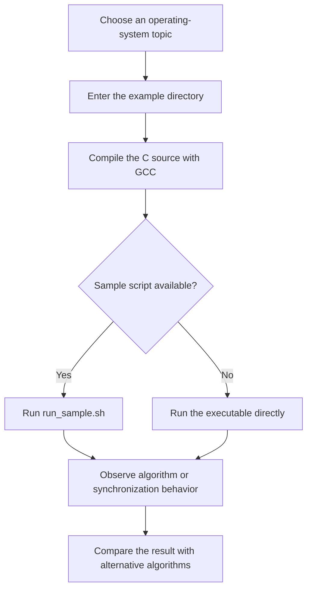

<div align="center">

# Operating System Programs

### A practical collection of C implementations for exploring core operating-system concepts

<p>
  <a href="https://github.com/Jeania-2k5/Operating_System_Programs">
    
  </a>
  <a href="https://en.wikipedia.org/wiki/POSIX">
    
  </a>
  <a href="https://github.com/Jeania-2k5/Operating_System_Programs">
    
  </a>
</p>

<p>
  <a href="#-overview">Overview</a> •
  <a href="#-program-catalogue">Catalogue</a> •
  <a href="#-setup">Setup</a> •
  <a href="#-usage">Usage</a> •
  <a href="#-roadmap">Roadmap</a>
</p>

</div>

> **Learning repository:** Each numbered directory is an independent example
> that can be compiled and studied on its own.

## 📑 Table of Contents

- [Overview](#-overview)
- [Key Features](#-key-features)
- [Program Catalogue](#-program-catalogue)
- [Technical Architecture & Engineering Details](#️-technical-architecture--engineering-details)
- [Workflow](#-workflow)
- [Visual Gallery](#-visual-gallery)
- [Setup](#-setup)
- [Usage](#-usage)
- [Repository File Structure](#-repository-file-structure)
- [Results / Findings](#-results--findings)
- [Algorithm Comparisons](#-algorithm-comparisons)
- [Roadmap](#-roadmap)
- [Disclaimer / Limitations](#️-disclaimer--limitations)
- [Contributing](#-contributing)
- [License](#-license)
- [Author / Contact](#-author--contact)

## 📖 Overview

This repository demonstrates fundamental operating-system mechanisms and
resource-management algorithms through small, focused C programs. The
examples move from process creation and POSIX threads to synchronization,
CPU scheduling, memory management, virtual memory, disk scheduling, and file
allocation.

The programs are intentionally interactive or observable: they print process
identifiers, scheduling metrics, allocation decisions, synchronization events,
page-fault counts, or disk-head movement so that the underlying behavior can
be studied directly.

## ✨ Key Features

- **Process control:** Create a child process with `fork()`, replace its
  program image with `exec()`, and synchronize with `wait()`.
- **Parallel computation:** Divide a sum across POSIX threads and join the
  workers.
- **CPU scheduling:** Compare FCFS, non-preemptive SJF, non-preemptive
  priority scheduling, and round robin.
- **Concurrency problems:** Explore producer-consumer, readers-writers, and
  dining philosophers using POSIX semaphores.
- **Deadlock avoidance:** Check safe states and resource requests with the
  Banker's algorithm.
- **Memory allocation:** Compare first-fit, best-fit, and worst-fit placement.
- **Page replacement:** Measure page faults for FIFO, LRU, and optimal
  replacement.
- **Disk scheduling:** Calculate head movement for FCFS, SSTF, SCAN, and
  C-SCAN.
- **File allocation:** Demonstrate contiguous, linked, and indexed allocation.

## 🧭 Program Catalogue

| # | Directory | Source | Focus |
|---:|---|---|---|
| 01 | [`01_process_creation/`](./01_process_creation/) | `fork_exec.c` | `fork()`, `exec()`, `wait()` |
| 02 | [`02_pthreads/`](./02_pthreads/) | `thread_sum.c` | POSIX threads and parallel summation |
| 03 | [`03_cpu_scheduling/`](./03_cpu_scheduling/) | `scheduling.c` | FCFS, SJF, priority, round robin |
| 04 | [`04_producer_consumer/`](./04_producer_consumer/) | `producer_consumer.c` | Bounded-buffer synchronization |
| 05 | [`05_readers_writers/`](./05_readers_writers/) | `readers_writers.c` | Shared-resource synchronization |
| 06 | [`06_dining_philosophers/`](./06_dining_philosophers/) | `dining_philosophers.c` | Semaphore-based deadlock avoidance |
| 07 | [`07_bankers_algorithm/`](./07_bankers_algorithm/) | `bankers.c` | Safe-state and resource-request checks |
| 08 | [`08_memory_allocation/`](./08_memory_allocation/) | `memory_allocation.c` | First-fit, best-fit, worst-fit |
| 09 | [`09_page_replacement/`](./09_page_replacement/) | `page_replacement.c` | FIFO, LRU, optimal replacement |
| 10 | [`10_disk_scheduling/`](./10_disk_scheduling/) | `disk_scheduling.c` | FCFS, SSTF, SCAN, C-SCAN |
| 11 | [`11_file_allocation/`](./11_file_allocation/) | `file_allocation.c` | Contiguous, linked, indexed allocation |

## ⚙️ Technical Architecture & Engineering Details

### Technologies

- C11-style source compatible with GCC or another C compiler
- POSIX process, thread, and semaphore APIs where required
- Bash sample scripts for repeatable demonstrations
- Mermaid for the conceptual workflow documented below

### System calls and APIs

The process example uses `fork()`, `getpid()`, `getppid()`, `execlp()`,
`wait()`, and `_exit()`. The threaded examples use POSIX thread functions
such as `pthread_create()` and `pthread_join()`. Synchronization examples
use POSIX semaphores through operations including `sem_wait()` and
`sem_post()`.

### Algorithms

The repository includes scheduling, allocation, replacement, and resource
management algorithms rather than a single shared application architecture.
Each directory owns its source file, executable name, inputs, and output
behavior.

## 🔄 Workflow



## 🖼️ Visual Gallery

These placeholders are reserved for future screenshots of representative
program executions. No screenshots are included or fabricated by this
repository documentation.

| Process creation | CPU scheduling | Synchronization |
|---|---|---|
| `` | `` | `` |

| Memory and paging | Disk scheduling | File allocation |
|---|---|---|
| `` | `` | `` |

> The image paths above are documentation placeholders only; the referenced
> image files are not currently part of the repository.

## 🛠️ Setup

### Prerequisites

- Git
- GCC or a compatible C compiler
- Bash for the optional sample scripts
- A POSIX-compatible environment for `fork()`, pthreads, and semaphores


No external libraries are required beyond the standard C library and the
POSIX interfaces provided by the target operating system.

## ▶️ Usage

Compile and run each program from its own directory. The executable names
below match the repository's sample scripts and documented workflow.

### 01. Process creation

```bash
cd 01_process_creation
gcc -Wall -Wextra -o fork_exec fork_exec.c
./fork_exec
```

### 02. POSIX threads

```bash
cd 02_pthreads
gcc -Wall -Wextra -pthread -o thread_sum thread_sum.c
./thread_sum
```

### 03. CPU scheduling

```bash
cd 03_cpu_scheduling
gcc -Wall -Wextra -o scheduling scheduling.c
./scheduling
```

### 04. Producer-consumer

```bash
cd 04_producer_consumer
gcc -Wall -Wextra -pthread -o pc producer_consumer.c
./pc
```

### 05. Readers-writers

```bash
cd 05_readers_writers
gcc -Wall -Wextra -pthread -o rw readers_writers.c
./rw
```

### 06. Dining philosophers

```bash
cd 06_dining_philosophers
gcc -Wall -Wextra -pthread -o dp dining_philosophers.c
./dp
```

### 07. Banker's algorithm

```bash
cd 07_bankers_algorithm
gcc -Wall -Wextra -o bankers bankers.c
./bankers
```

### 08. Memory allocation

```bash
cd 08_memory_allocation
gcc -Wall -Wextra -o memory memory_allocation.c
./memory
```

### 09. Page replacement

```bash
cd 09_page_replacement
gcc -Wall -Wextra -o pages page_replacement.c
./pages
```

### 10. Disk scheduling

```bash
cd 10_disk_scheduling
gcc -Wall -Wextra -o disk disk_scheduling.c
./disk
```

### 11. File allocation

```bash
cd 11_file_allocation
gcc -Wall -Wextra -o files file_allocation.c
./files
```

### Sample scripts

Where provided, compile the executable shown above and run:

```bash
./run_sample.sh
```

The scripts run from their own directory and write demonstration output to
that directory's `output.txt`.

## 🗂️ Repository File Structure

```text
Operating_System_Programs/
├── 01_process_creation/
│   ├── fork_exec.c
│   └── run_sample.sh
├── 02_pthreads/
│   ├── thread_sum.c
│   └── run_sample.sh
├── 03_cpu_scheduling/
│   ├── scheduling.c
│   └── run_sample.sh
├── 04_producer_consumer/
│   ├── producer_consumer.c
│   └── run_sample.sh
├── 05_readers_writers/
│   ├── readers_writers.c
│   └── run_sample.sh
├── 06_dining_philosophers/
│   ├── dining_philosophers.c
│   └── run_sample.sh
├── 07_bankers_algorithm/
│   ├── bankers.c
│   └── run_sample.sh
├── 08_memory_allocation/
│   ├── memory_allocation.c
│   └── run_sample.sh
├── 09_page_replacement/
│   ├── page_replacement.c
│   └── run_sample.sh
├── 10_disk_scheduling/
│   ├── disk_scheduling.c
│   └── run_sample.sh
├── 11_file_allocation/
│   ├── file_allocation.c
│   └── run_sample.sh
└── README.md
```

## 📊 Results / Findings

The examples are designed to expose trade-offs rather than provide one
universally best algorithm:

- CPU scheduling shows how arrival time, burst time, priority, and time
  quantum affect waiting and turnaround time.
- Memory allocation illustrates how placement strategy changes which
  processes fit into available blocks.
- Page replacement compares how replacement decisions affect page faults for
  the same reference string and frame count.
- Disk scheduling demonstrates how request ordering affects total head
  movement.
- Synchronization examples make ordering, mutual exclusion, and shared-state
  access observable through program output.

No fixed numerical results are claimed here because program results depend on
the input values supplied at runtime and, for concurrent programs, execution
interleaving.

## ⚖️ Algorithm Comparisons

### CPU Scheduling

| Algorithm | Selection rule | Typical trade-off |
|---|---|---|
| FCFS | Run processes in arrival order | Simple and predictable, but can cause convoy effects |
| SJF | Select the available process with the shortest burst time | Can reduce waiting time, but may delay long jobs |
| Priority | Select the available process with the best priority value | Prioritizes urgent work, but can starve lower-priority work |
| Round Robin | Give each process a fixed time quantum | Fair and responsive, with context-switch overhead influenced by the quantum |

### Memory Allocation

| Strategy | Placement rule | Main characteristic |
|---|---|---|
| First fit | Use the first block large enough | Fast search and straightforward placement |
| Best fit | Use the smallest block that is large enough | Attempts to reduce leftover space in the selected block |
| Worst fit | Use the largest available block | Leaves a larger remainder in the selected block |

### Page Replacement

| Algorithm | Replacement rule | Main characteristic |
|---|---|---|
| FIFO | Replace the page that entered first | Simple, but does not use recent-use information |
| LRU | Replace the least recently used page | Uses recent history to approximate locality |
| Optimal | Replace the page used farthest in the future | Useful as a comparison baseline, but requires future reference knowledge |

### Disk Scheduling

| Algorithm | Request order | Main characteristic |
|---|---|---|
| FCFS | Original request order | Fair and simple, but may create unnecessary movement |
| SSTF | Closest pending request | Often reduces immediate movement, but may delay distant requests |
| SCAN | Sweep toward an end, then reverse | Services requests in a predictable elevator-like pattern |
| C-SCAN | Sweep in one direction, then return to the beginning | Provides a more uniform circular service pattern |

## 🗺️ Roadmap

The following are potential improvements, not currently implemented features:

- Add focused input validation and clearer error messages.
- Add automated tests for representative algorithm cases.
- Add consistent command-line input options for non-interactive use.
- Add screenshots or terminal recordings to replace the gallery placeholders.
- Add complexity notes and more detailed per-program explanations.
- Add a project-wide build system or Makefile.

## ⚠️ Disclaimer / Limitations

- These programs are educational demonstrations, not production operating
  system components.
- POSIX-specific examples require a compatible environment; they may not
  compile or behave identically on native Windows without a POSIX layer.
- Concurrent output order can vary between executions because thread
  scheduling is nondeterministic.
- Several examples use fixed-size arrays and constants defined in their source
  files, so input ranges are bounded by each implementation.
- The repository does not claim benchmark-quality performance measurements.

## 🤝 Contributing

Contributions that improve correctness, clarity, portability, or educational
value are welcome:

1. Fork the repository.
2. Create a focused branch for your change.
3. Make the smallest change that addresses the improvement.
4. Compile and test the affected example.
5. Open a pull request describing the change and how it was verified.

Please keep examples readable, preserve the purpose of each directory, and
avoid committing generated executables or `output.txt` files.

## 📄 License

No license file is currently provided in this repository. Unless a license is
added, repository contents remain subject to the applicable default copyright
rules.

## 👤 Author / Contact

**Krishna Budhaniya**

- GitHub: 
- Repository: 

<p align="center">
  <a href="#operating-system-programs">⬆️ Back to top</a>
</p>
